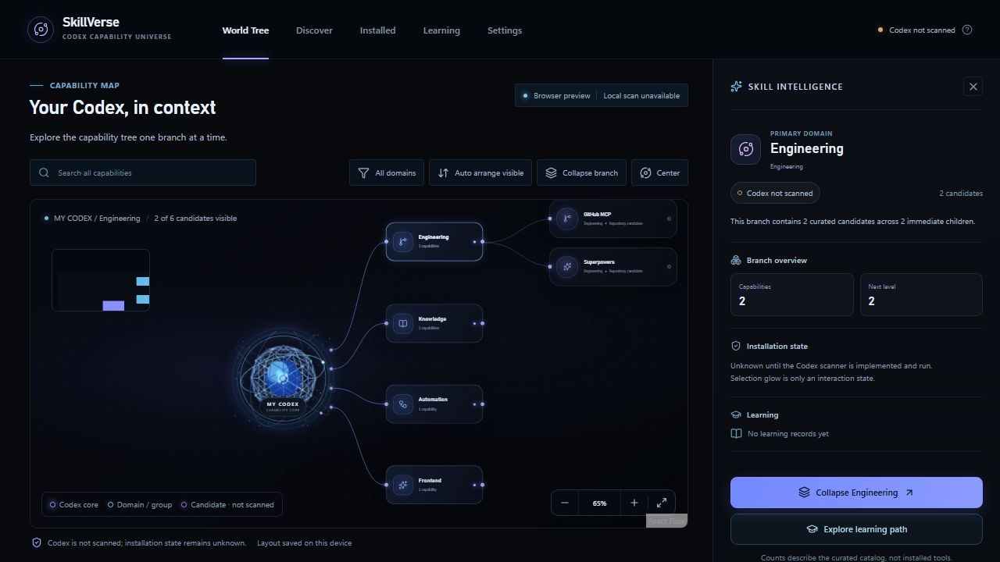
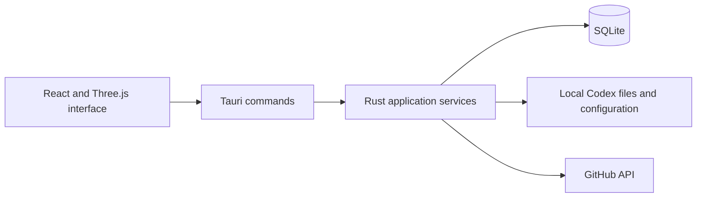

# SkillVerse AI

SkillVerse AI is a Windows desktop application for finding, reviewing, and managing Codex skills, plugins, and MCP server capabilities from GitHub and local sources. It helps a user inspect what a capability does, then install or update selected items in a local Codex environment through an explicit review flow.

## What the app does

- Explore capability entries in a navigable 3D interface and search local or GitHub-hosted sources.
- Inspect capability metadata and compatibility information before making changes.
- Review installation plans for supported Codex skills, plugins, and MCP configuration.
- Track application data and local workflow state in SQLite.
- Keep downloaded content as files/configuration for review; installation does not execute downloaded scripts or start MCP processes.

## Interface



The screenshot shows the app's browser preview. Native Codex scanning and file operations require the Windows desktop build.

## Technology and structure

React, TypeScript, Vite, Three.js / React Three Fiber, Tauri 2, Rust, and SQLite.



The frontend presents discovery and review workflows. Tauri commands connect it to Rust services for local scanning, capability handling, persistence, and approved file operations.

## Run on Windows

Install Node.js and the [Tauri Windows prerequisites](https://v2.tauri.app/start/prerequisites/), then run from `app`:

```powershell
npm ci
npm run tauri:dev
```

To build the desktop application:

```powershell
npm run tauri:build
```

`npm run dev` starts a browser preview; it does not provide native Codex file access. GitHub features require network access. Keep tokens and local Codex configuration on the machine; do not commit them.

## Scope

The application is a personal software project. Installation and update operations are designed around preview and user confirmation. Real-user Codex installation should be verified on the target machine before relying on it.
